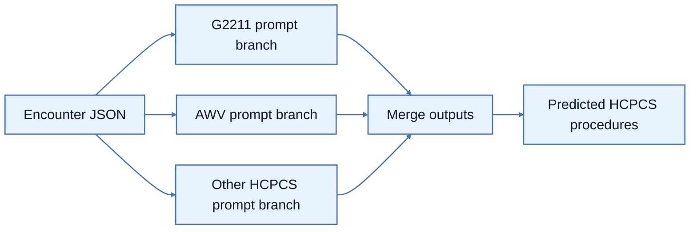
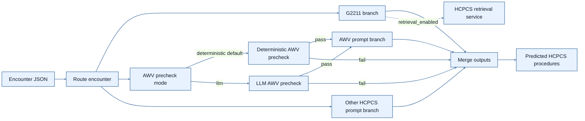
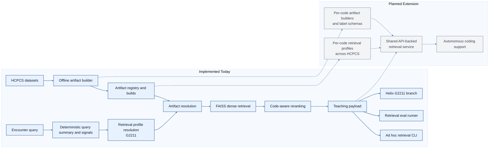

# HCPCS Codes Models

This document explains how to run the HCPCS baseline `baseline_llm` model, the
advanced `helix` model, the standalone HCPCS retrieval system, and the
supporting evaluation workflows.

## Directory Map

- `models/baseline_llm/` – The strict prompt-only HCPCS baseline.
- `models/helix/` – The advanced HCPCS model with routing, AWV eligibility
  precheck, and optional retrieval augmentation.
- `rag/` – Standalone HCPCS retrieval package.
  - `README.md` – System overview, current scope, and roadmap toward broader
    HCPCS and autonomous coding support.
  - `service.py` – Query-time `RetrievalService`.
  - `profiles.py` – Code-specific retrieval profiles and limits.
  - `artifacts.py` – Versioned artifact manifests and registry selection.
  - `vector_store.py` – FAISS loading/search and embedding resolution.
  - `builder/` – Offline artifact generation.
- `eval_runner.py` – Entrypoint for evaluating the model on JSON datasets.
- `scripts/profees_coding/hcpcs_codes/llm_only_ablation.sh` – Batch driver for
  the baseline `llm_only` model.
- `scripts/profees_coding/hcpcs_codes/helix_ablation.sh` – Batch driver for the
  advanced `helix` model.
- `scripts/profees_coding/hcpcs_codes/retrieval_ablation.sh` – Batch driver for
  retrieval-only experiments.
- `scripts/profees_coding/hcpcs_codes/report_error_rows.py` – Aggregates error
  rows from the generated `sample_report.csv` files and surfaces them for SME
  review.

## Architecture

### Baseline Model Diagram



- `baseline_llm` is intentionally shallow: no encounter routing, no AWV
  eligibility precheck, and no retrieval call.

### Helix Model Diagram



- `helix` is the advanced predictor. It routes the encounter, runs the AWV
  eligibility precheck through a mode selector, and can optionally augment the
  `G2211` branch through the internal `RagClient` seam.
- `helix` AWV precheck supports two modes through `awv_precheck_mode`:
  `deterministic` and `llm`.
- `deterministic` is the default path. It uses the fail-closed eligibility
  rules without calling the AWV plan-interpretation LLM step.
- `llm` preserves the legacy compatibility path, where the AWV precheck can use
  the LLM-based plan interpretation step before the AWV classifier.
- When the AWV precheck fails in either mode, `helix` now exits the AWV branch
  early, emits no AWV procedure code, and records the reason under
  `additional_output["awv"]["awv_precheck"]`.
- `helix` retrieval no longer mutates the SOAP note text. Retrieved examples are
  injected through structured `additional_input` fields such as
  `retrieval`, `retrieval_examples`, and `retrieval_prompt_block`.

### RAG System Diagram

Implemented components are shown in blue. Planned extensions are shown in gray.



- `rag` is now an independent retrieval and teaching layer rather than a helper
  hidden inside one predictor.
- Today it is implemented for `G2211`, with offline artifact builds,
  deterministic query-time retrieval, standalone evaluation, and optional
  `helix` integration.
- The planned direction is to extend the retrieval-profile system across HCPCS
  code families, move toward a shared service boundary, and use RAG as domain
  memory for more autonomous coding workflows.
- See [`rag/README.md`](rag/README.md) for the fuller system overview and
  roadmap.

### Retrieval Runtime

At query time, the HCPCS retrieval system now follows a fixed service path:

1. Build a deterministic query summary and retrieval signals from the encounter,
   cached summary data, and `additional_input`.
2. Resolve the target-code retrieval profile.
3. Resolve the newest ready local artifact from `registry.json` unless a build
   is explicitly pinned.
4. Run FAISS dense retrieval.
5. Apply code-aware reranking and balanced label selection.
6. Return a compact prompt payload with:
   - similar encounter summary
   - label
   - teaching justification
   - matched signals

- For the first production implementation, the supported retrieval profile is
  `G2211`.
- The current runtime is designed around retrieval profiles so the same service
  contract can later support additional HCPCS codes and code families.

### Retrieval Artifacts

Retrieval artifacts are versioned under an artifact root, typically:

```text
cdrc/profees_coding/hcpcs_codes/artifacts/rag/g2211/
  registry.json
  builds/<build_id>/
    manifest.json
    metadata.jsonl
    summaries.jsonl
    full_summary_sidecar.jsonl
    index.faiss
```

- `registry.json` tracks ready builds and lets runtime default to the newest
  compatible artifact.
- `manifest.json` records build metadata such as summary model, prompt hash,
  dataset fingerprint, and embedding model.
- `metadata.jsonl` stores the retrieval records used at query time, including
  label, compact summary, signals, and offline teaching justification.
- The long-term intent is for this artifact pattern to generalize from one
  `G2211` memory store into a library of code-aware teaching artifacts across
  HCPCS.

## Quick Start

1. Activate the project virtualenv (required for all commands):
   ```bash
   source ../../cdrc/bin/activate
   ```
2. Ensure your Git workspace is on the desired branch (e.g.,
   `menyuan/hcpcs_codes_model`).
3. Choose the runner config that matches the model you want to evaluate:
   - `models/baseline_llm/config/runner.yaml`
   - `models/helix/config/runner.yaml`

   The branch selectors are:
   - `g2211_prompt_version`
   - `awv_prompt_version`
   - `awv_eligibility_prompt_version`
   - `awv_precheck_mode`
   - `other_prompt_version`

   Example:
   ```yaml
   g2211_prompt_version: v4.4
   awv_prompt_version:
     name: AWV only
     version: v5.1
     codes_supported:
       - G0402
       - G0438
       - G0439
   awv_eligibility_prompt_version: v5.4
   awv_precheck_mode: deterministic
   other_prompt_version:
     name: Other HCPCS facility
     version: v6.1
     codes_supported:
       - Other HCPCS codes
   ```

## Running the Model Once

Use `eval_runner.py` to evaluate a single dataset/model combination.

Baseline `baseline_llm`:

```bash
python cdrc/profees_coding/hcpcs_codes/eval_runner.py \
  --config_path cdrc/profees_coding/hcpcs_codes/models/baseline_llm/config/runner.yaml \
  --model_variant baseline_llm \
  --data_path /path/to/dataset.json \
  --g2211_prompt_version v4.4 \
  --awv_prompt_version v5.1 \
  --other_prompt_version v6.1 \
  --model_name caa-gpt-5.2-2025-12-11-dev-sds \
  --model_kwargs '{"temperature":1.0,"reasoning_effort":"low","seed":42}' \
  --batch_size 16 \
  --run_name my_eval \
  --output_dir ./results_hcpcs/my_eval
```

Advanced `helix`:

```bash
python cdrc/profees_coding/hcpcs_codes/eval_runner.py \
  --config_path cdrc/profees_coding/hcpcs_codes/models/helix/config/runner.yaml \
  --model_variant helix \
  --retrieval_enabled false \
  --data_path /path/to/dataset.json \
  --g2211_prompt_version v4.4 \
  --awv_prompt_version v5.1.2 \
  --awv_eligibility_prompt_version v5.4 \
  --awv_precheck_mode deterministic \
  --other_prompt_version v6.1 \
  --model_name caa-gpt-5.4-2026-03-05-dev-sds \
  --model_kwargs '{"temperature":1.0,"reasoning_effort":"low","seed":42}' \
  --batch_size 16 \
  --run_name my_helix_eval \
  --output_dir ./results_hcpcs/my_helix_eval
```

Standalone retrieval-only evaluation:

```bash
python cdrc/profees_coding/hcpcs_codes/rag/eval_runner.py \
  --config_path cdrc/profees_coding/hcpcs_codes/rag/config/runner.yaml \
  --data_path /path/to/dataset.json \
  --feature_name G2211 \
  --artifact_selection latest_registry \
  --artifact_root ./cdrc/profees_coding/hcpcs_codes/artifacts/rag/g2211 \
  --retrieval_top_k 4 \
  --positive_example_limit 2 \
  --negative_example_limit 2 \
  --run_name my_rag_eval \
  --output_dir ./results_hcpcs/rag
```

Interactive ad hoc retrieval:

```bash
python -m cdrc.profees_coding.hcpcs_codes.rag
```

The interactive CLI is standalone retrieval-only. It currently supports
`G2211`, asks for SOAP note text plus client name, assumes all ad hoc queries
are ambulatory, and prints retrieved encounters directly in the terminal.

To pin a specific retrieval build for evaluation, add:

```bash
--artifact_build_id <build_id>
```

Key flags:

- `--data_path` – Path to JSON file compatible with `InputSchema`.
- `--model_variant` – `baseline_llm` or `helix`.
- `--retrieval_enabled` – Helix-only retrieval toggle.
- `--g2211_prompt_version` – Override the G2211 branch prompt version.
- `--awv_prompt_version` – Override the AWV classifier branch prompt version.
- `--awv_eligibility_prompt_version` – Override the AWV eligibility precheck prompt version.
- `--awv_precheck_mode` – Helix-only AWV precheck selector:
  `deterministic` (default) or `llm`.
- `--other_prompt_version` – Override the facility-context other-HCPCS branch prompt version.
- `--include_justification` – Add verbose `hcpcs_debug` payloads for manual
  review.
- `--previous_run` – Provide a CSV path to re-compute metrics/build reports
  without re-generating LLM outputs.

On AWV precheck failure, the Helix AWV branch emits no AWV code and stores
failure metadata under `additional_output["awv"]["awv_precheck"]`. That
payload includes the mode, hard-block list, human-readable justification, and
the full eligibility snapshot used for the decision.

Retrieval-only runner flags:

- `--artifact_selection` – Usually `latest_registry`.
- `--artifact_root` – Artifact directory containing `registry.json`.
- `--artifact_build_id` – Optional exact build pin.
- `--retrieval_top_k` – Final number of retrieved examples.
- `--retrieval_candidate_pool_size` – Dense-search pool before reranking.
- `--positive_example_limit` – Max positive-label examples selected.
- `--negative_example_limit` – Max negative-label examples selected.
- `--vdb_dir`, `--summary_cache_path` – Legacy pinned-artifact options kept for
  migration compatibility.

Outputs land in `--output_dir/--run_name/`:

- `sample_report.csv` – per-encounter details, including predicted vs. gold
  codes and instance-level precision/recall.
- `summary_report.csv` – aggregated metrics per code and micro/macro scores.
- `token_usage_report.csv` (when token stats are available).

Standalone retrieval-only outputs land in `--output_dir/--run_name/` and
include:

- `retrieval_results.jsonl` – Full per-query retrieval payloads.
- `retrieval_report.csv` – Flattened retrieved-example report.
- `retrieval_summary.json` – Aggregate retrieval run summary.

## Building or Refreshing Retrieval Artifacts

Use the builder entrypoint to create a new versioned retrieval artifact when the
summary model, prompt, or source datasets change:

```bash
python cdrc/profees_coding/hcpcs_codes/rag/builder/service.py \
  --config_path cdrc/profees_coding/hcpcs_codes/rag/builder/config/g2211.yaml
```

Useful builder overrides:

- `--model_name` – Summary-generation model name.
- `--model_kwargs` – JSON string of model kwargs.
- `--data_paths` – One or more dataset files.
- `--embedding_model_name` – Embedding model for FAISS vectors.
- `--artifact_root` – Where the new build and `registry.json` should be written.
- `--build_label` – Optional suffix added to the generated build id.

Older scripts may still reference
`cdrc/profees_coding/hcpcs_codes/rag/g2211/build_vdb.py`; that path now exists
only as a compatibility wrapper around the builder package.

## Batch Evaluations (Ablations)

The baseline `llm_only_ablation.sh` script runs a grid of datasets × models ×
reasoning efforts × seeds for `baseline_llm`.

Run it from the repo root:

```bash
./scripts/profees_coding/hcpcs_codes/llm_only_ablation.sh
```

The advanced `helix_ablation.sh` script runs the same style of sweep for the
`helix` model and includes the AWV-eligibility branch plus the public
`RETRIEVAL_ENABLED` toggle.

Run it from the repo root:

```bash
./scripts/profees_coding/hcpcs_codes/helix_ablation.sh
```

The standalone `retrieval_ablation.sh` script runs retrieval-only sweeps over
dataset, retrieval pool, and example-selection settings.

Run it from the repo root:

```bash
./scripts/profees_coding/hcpcs_codes/retrieval_ablation.sh
```

Customize the arrays near the top of the scripts as needed:

- `G2211_PROMPT_VERSIONS`, `AWV_PROMPT_VERSIONS`,
  `AWV_ELIGIBILITY_PROMPT_VERSIONS`, `OTHER_PROMPT_VERSIONS` – Per-branch
  prompt sweeps.
- `MODELS`, `REASONING_EFFORTS`, `SEEDS` – Arrays to sweep.
- `FEATURES` – Retrieval profile list in `retrieval_ablation.sh`.
- `RETRIEVAL_TOP_K_VALUES`, `RETRIEVAL_POOL_VALUES` – Retrieval sweep settings.
- `DATASETS` – List of dataset paths.
- `INCLUDE_JUSTIFICATION` – `true` or `false` for additional debug outputs.

Run it from the repo root:

```bash
./scripts/profees_coding/hcpcs_codes/llm_only_ablation.sh
```

The advanced `helix_ablation.sh` script runs the same style of sweep for the
`helix` model and includes the AWV-eligibility branch plus the public
`RETRIEVAL_ENABLED` toggle.

Run it from the repo root:

```bash
./scripts/profees_coding/hcpcs_codes/helix_ablation.sh
```

The standalone `retrieval_ablation.sh` script runs retrieval-only sweeps over
dataset, retrieval pool, and example-selection settings.

Run it from the repo root:

```bash
./scripts/profees_coding/hcpcs_codes/retrieval_ablation.sh
```

Customize the arrays near the top of the scripts as needed:

- `G2211_PROMPT_VERSIONS`, `AWV_PROMPT_VERSIONS`,
  `AWV_ELIGIBILITY_PROMPT_VERSIONS`, `OTHER_PROMPT_VERSIONS` – Per-branch
  prompt sweeps.
- `MODELS`, `REASONING_EFFORTS`, `SEEDS` – Arrays to sweep.
- `FEATURES` – Retrieval profile list in `retrieval_ablation.sh`.
- `RETRIEVAL_TOP_K_VALUES`, `RETRIEVAL_POOL_VALUES` – Retrieval sweep settings.
- `DATASETS` – List of dataset paths.
- `INCLUDE_JUSTIFICATION` – `true` or `false` for additional debug outputs.
- `RETRIEVAL_ENABLED` – Helix-only toggle in `helix_ablation.sh`.
- `AWV_PRECHECK_MODE` – Helix AWV precheck selector when you want to override
  the default deterministic path in scripts.
- `EXAMPLE_LIMIT_VALUES` – Symmetric positive/negative retrieval example cap in
  `retrieval_ablation.sh`.

Each combination writes results to `./results_hcpcs/<experiment>/<run>/` and
teed logs to `<experiment>/<run>/log.txt`.

## Reviewing Errors

After an evaluation or ablation, use `report_error_rows.py` to aggregate rows
where predictions and gold labels disagree:

```bash
python scripts/profees_coding/hcpcs_codes/report_error_rows.py \
  --results_root ./results_hcpcs \
  --codes G2211 G0439 \
  --limit 100
```

This produces:

- `results_hcpcs/error_rows.csv` – Full list of mismatched encounters with input
  metadata, predicted vs. gold codes, and per-instance metrics.
- `results_hcpcs/error_rows.md` – Optional Markdown table (limited via
  `--limit`) suitable for SME review.

## Prompt Development Tips

1. Add new prompt versions under the matching model package:
   - `models/baseline_llm/config/prompts.yaml`
   - `models/helix/config/prompts.yaml`
2. Update `runner.yaml` (or CLI overrides) for the specific branch you are
   tuning.
3. Use branch-local metadata in `runner.yaml` to document which codes each
   prompt is tuned to predict.
4. If `helix` retrieval is enabled, make sure the prompt version consumes
   `additional_input`; retrieval examples now arrive there rather than being
   appended to the note body.
5. Run targeted evaluations before launching large ablations.

## Troubleshooting

- **Authentication failures** when pulling/pushing or calling remote models:
  ensure the environment is activated (`source ../../cdrc/bin/activate`) and
  YubiKey smart-card auth is unlocked in your `ssh-agent`.
- **Empty `results_hcpcs`** directory: confirm paths in `llm_only_ablation.sh`,
  `helix_ablation.sh`, or `retrieval_ablation.sh` and permissions to dataset
  mount points.
- **No `sample_report.csv`** in a run: check `log.txt` for Python exceptions,
  prompt version typos, or JSON parsing errors.
- **Retrieval run says `missing_artifact`**: build or register a retrieval
  artifact under the configured `artifact_root`, or pin a legacy `vdb_dir`.

Reach out to the HCPCS coding team or SMEs with the Markdown error table for
fast feedback on mislabeled encounters or prompt regressions.
