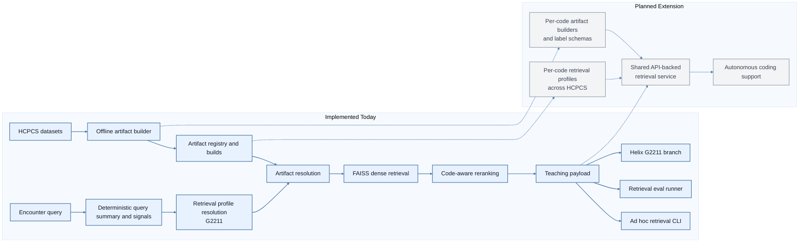

# HCPCS RAG System

This package is the independent retrieval layer for HCPCS coding research.

It is intentionally broader than "retrieve a few examples and stuff them into a
prompt." The goal is to build domain memory for HCPCS coding so downstream
models can reason with better local coding priors, clearer boundary cases, and
more reusable teaching artifacts.

Today, that work is deliberately scoped to `G2211`. The longer-term direction
is to extend the same retrieval contract across HCPCS code families and use it
as a foundation for more autonomous coding workflows.

## Why This Exists

Prompting, exclusions, and rubric patches can improve HCPCS performance, but
they still rely on a generic model to improvise the final coding judgment.

This RAG system is meant to shift part of that burden from "generic reasoning"
to "domain-shaped memory." Instead of asking the model to reason from scratch
every time, retrieval can provide:

- similar encounters
- positive examples
- hard negative examples
- teaching justifications
- decision-relevant matched signals

The intended effect is not just higher recall or precision on one code. The
intended effect is to teach the model what the coding boundary looks like.

## System Goal

The RAG subsystem is meant to become a reusable HCPCS teaching layer that can:

- run retrieval experiments independently of the predictor
- serve prompt-ready teaching examples to model consumers
- grow from one retrieval profile to many code-specific profiles
- evolve into an API-backed medical-coding service
- eventually support more autonomous coding behavior

## Current Scope

The first production implementation is intentionally narrow:

- the only implemented retrieval profile is `G2211`
- query-time retrieval is deterministic and LLM-free
- offline artifact generation may use an LLM to summarize and teach
- retrieval can be run independently through a CLI and evaluation runner
- `helix` can consume retrieval through the `RagClient` seam

That scope is small on purpose. It keeps retrieval easy to inspect while the
contract matures.

## Whole-Picture Diagram

Implemented components are shown in blue. Planned extensions are shown in gray.



## Implemented System Today

The current retrieval path has two distinct stages.

### 1. Offline artifact build

The artifact builder prepares reusable retrieval memory ahead of time:

1. Load labeled encounters for the target code.
2. Generate compact and full encounter summaries.
3. Build metadata records with labels, summaries, signals, and teaching text.
4. Embed the summaries and write the FAISS index.
5. Write a manifest and register the build in `registry.json`.

This gives query-time retrieval a stable artifact to consume.

### 2. Deterministic query-time retrieval

At query time, `RetrievalService.retrieve(...)` does the following:

1. Resolve the target retrieval profile.
2. Route the encounter as ambulatory or facility.
3. Build a deterministic query summary and retrieval signals.
4. Resolve the newest compatible artifact, or a pinned build.
5. Embed the query summary and run FAISS dense retrieval.
6. Apply code-aware reranking and balanced positive/negative selection.
7. Return a compact teaching payload for the downstream consumer.

The returned payload can include:

- retrieved encounter summaries
- labels
- teaching justifications
- matched signals
- diagnostics such as label distribution and artifact build id

## Why The System Is Independent

This subsystem is separated from the main HCPCS predictor for two reasons.

First, it makes research cleaner. Retrieval can be evaluated on its own instead
of being hidden inside a larger prediction graph.

Second, it creates a better long-term interface. A retrieval system that can
run independently can later be served through a local client or HTTP boundary
instead of being tightly coupled to one model variant.

That is why `helix` consumes retrieval through `RagClient`, and why the RAG
runtime also has standalone entry points for evaluation and ad hoc inspection.

## How This Connects To HCPCS Coding

The current `G2211` implementation is the first retrieval profile because it is
a high-value boundary-heavy coding problem:

- positive cases depend on longitudinal care and continuing responsibility
- false positives often sound superficially plausible
- hard negatives matter almost as much as positives

That made `G2211` a good place to mature the retrieval contract before trying
to scale it across more HCPCS codes.

In the broader HCPCS stack, RAG is currently a consumer-facing teaching layer:

- the standalone retrieval runner measures retrieval quality directly
- the ad hoc CLI helps inspect the retrieved teaching cases
- `helix` can optionally consume retrieval for `G2211`

## Path To All HCPCS Codes

The current design is intentionally built around the idea of retrieval profiles.
That is the main seam for future extension.

To extend from `G2211` to the full HCPCS space, the likely path is:

1. Add more retrieval profiles, each with code-specific label normalization,
   signal sections, section weights, and allowed routes.
2. Add per-code or per-family artifact builders so each code family can define
   the right summary schema and teaching artifact format.
3. Support different decision structures for different code families:
   ambulatory continuity codes, AWV/IPPE codes, screening codes, prolonged
   service codes, and facility-style administration codes will not share the
   same similarity definition.
4. Expand the artifact registry from one-code memory to a library of
   code-specific teaching artifacts.
5. Keep the runtime contract stable so predictors can consume retrieval without
   depending on code-family-specific storage internals.

The goal is not one giant generic index. The goal is a shared retrieval
framework with code-aware profiles and code-aware teaching artifacts.

## Path To Autonomous Coding

The long-term intent is not to stop at prompt injection.

The deeper goal is to support more autonomous coding behavior by giving the
model a reusable teaching memory:

- similar cases
- boundary cases
- hard negatives
- structured teaching justifications
- code-specific decision signals

In that future direction, RAG can help an autonomous coding system do more than
answer "what code might apply?"

It can support questions like:

- What similar coding cases exist for this encounter?
- Which decision boundary is most relevant here?
- What evidence is missing for a stronger coding conclusion?
- Which negative analogies argue against overcoding?
- Which retrieved examples should be surfaced in an audit trail?

That is why this work is framed as a teaching layer rather than just a helper
utility. The autonomous-coding goal is still planned, not implemented, but the
current RAG contract is meant to make that direction possible.

## Current Limitations

- only `G2211` is implemented today
- query-time retrieval is deterministic and does not do online LLM reasoning
- retrieval is currently consumed only by the `helix` `G2211` branch
- SOAP-note similarity alone is not sufficient; the important work is in
  code-aware summarization, signal extraction, and reranking

## Main Files

- `service.py` - query-time `RetrievalService`
- `profiles.py` - retrieval profile registry and per-code configuration
- `summaries.py` - query-summary assembly and summary-section parsing
- `ranking.py` - code-aware reranking and matched-signal explanation
- `artifacts.py` - artifact manifests, registry handling, and build resolution
- `vector_store.py` - embedding and FAISS search helpers
- `clients.py` - local and HTTP clients for downstream consumers
- `eval_runner.py` - retrieval-only evaluation entry point
- `adhoc_cli.py` - interactive retrieval inspection CLI
- `builder/service.py` - offline artifact build entry point

## Runner Outputs

Use `cdrc/profees_coding/hcpcs_codes/rag/eval_runner.py` to run retrieval over a
dataset. It writes:

- `retrieval_results.jsonl` - nested per-query retrieval output
- `retrieval_report.csv` - flat report for spreadsheet inspection
- `retrieval_summary.json` - aggregate run summary

## Ad Hoc CLI Retrieval

For manual inspection, use the interactive CLI:

```bash
python -m cdrc.profees_coding.hcpcs_codes.rag
```

This starts an interactive retrieval session for the currently supported target
code, `G2211`.

The CLI behavior is:

- it treats ad hoc queries as ambulatory encounters
- it prompts for SOAP note text first
- enter `END` on its own line to submit the note
- `3` blank lines in a row will also auto-submit
- it then prompts for an optional client name
- type `:quit` at any prompt to exit

### Minimal Example

```text
$ python -m cdrc.profees_coding.hcpcs_codes.rag
HCPCS Interactive Retrieval CLI
Target code: G2211
Artifact selection: latest_registry
Artifact root: ./cdrc/profees_coding/hcpcs_codes/artifacts/rag/g2211
Retrieval top-k: 4
All ad hoc queries are treated as ambulatory encounters.

Paste SOAP note text. Enter END on its own line to finish. 3 blank lines will also submit. Type :quit to exit.
soap> Follow-up visit for diabetes and hypertension management.
Medication regimen reviewed and adjusted.
Return precautions discussed.
END
Client name is optional. Leave blank to skip.
client>

=== Retrieval Result ===
Target code: G2211
Status: ok
Artifact build id: <build_id>
Query summary source: summary_cache|additional_input|generated
Query signals: continuity, chronic_conditions, management_actions
...
```

### Pin A Specific Artifact Build

Use this when you want to inspect retrieval against a known build instead of
the newest registry entry:

```bash
python -m cdrc.profees_coding.hcpcs_codes.rag \
  --artifact_root ./cdrc/profees_coding/hcpcs_codes/artifacts/rag/g2211 \
  --artifact_build_id <build_id>
```

### Adjust Retrieval Limits

Use this when you want fewer or more retrieved teaching cases in the terminal:

```bash
python -m cdrc.profees_coding.hcpcs_codes.rag \
  --retrieval_top_k 6 \
  --positive_example_limit 3 \
  --negative_example_limit 3
```

### Useful Workflow

```bash
source ../../cdrc/bin/activate
python -m cdrc.profees_coding.hcpcs_codes.rag \
  --artifact_root ./cdrc/profees_coding/hcpcs_codes/artifacts/rag/g2211 \
  --retrieval_top_k 4
```

Use the CLI when you want to:

- inspect what the retrieval system thinks is similar for one encounter
- sanity-check whether the matched signals make sense
- review positive and negative teaching cases before wiring retrieval into a
  larger experiment

## Working Thesis

Prompt engineering can constrain a generic model, but retrieval may be the
first step toward teaching it how HCPCS coding judgment actually works.

That is the reason this subsystem is independent today and why its future scope
is larger than one prompt augmentation path.
